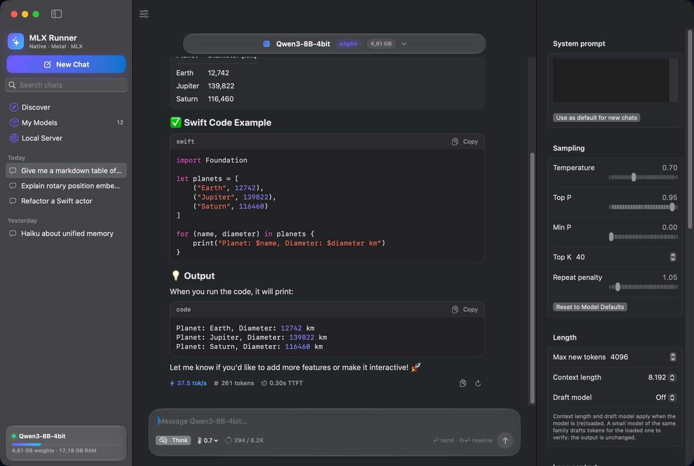

# MLX Runner

**Run MLX models on your Mac. Natively, fast, with nothing in between.**

A native macOS app for discovering, downloading and chatting with **MLX models from Hugging Face**, in the spirit of LM Studio. It is written entirely in Swift, with its own Metal inference engine. Made by [21no.de](https://21no.de).

**[Download at mlx-runner.21no.de](https://mlx-runner.21no.de)**: a `.dmg` for Apple silicon Macs (macOS 15+) and the `mlxr` command-line tool. Every release ships an Ed25519-signed `SHA256SUMS` and signed build provenance; see [verifying a download](#verifying-a-download).



- **Zero third-party dependencies.** The project uses the Swift standard library and Apple's system frameworks only: SwiftUI, Foundation, Metal, Network and CryptoKit. It has no SwiftPM packages, no vendored code and no Python.
- **Native MLX format.** It reads MLX-community repos directly: `safetensors` plus MLX affine quantization at 2, 3, 4, 5, 6 or 8 bits, with group sizes of 32, 64 or 128.
- **Fast.** Hand-written Metal kernels cover every layer:
  - fused decode matvecs
  - simdgroup-matrix GEMMs for prefill
  - flash attention
  - KV-cache prefix reuse across chat turns
- **Signed updates.** "Check for Updates…" installs a new release only after its Ed25519 signature, its SHA-256 and the app's code signature all verify, then swaps it in atomically and restarts.

> **On "native MLX support" with "no external dependencies":** Apple's `mlx-swift` is a third-party package, so it is not used. MLX Runner runs MLX *models* with an engine written from scratch on Metal instead. It loads the same files `mlx-lm` uses, so any compatible `mlx-community` repo works without conversion.

## Install

1. Download `MLX-Runner-<version>-macos-arm64.dmg` from [mlx-runner.21no.de](https://mlx-runner.21no.de) or the [releases page](https://github.com/BackendStack21/mlx-runner/releases/latest).
2. Open it and drag **MLX Runner** to Applications.
3. The app is ad-hoc signed, not notarized by Apple, so the first launch needs one extra step: right-click the app and choose **Open**, or run
   `xattr -dr com.apple.quarantine "/Applications/MLX Runner.app"`.

Later versions arrive through **MLX Runner → Check for Updates…**. The app checks GitHub at launch and every 6 hours; turn that off in Settings.

The CLI: unpack `mlxr-<version>-macos-arm64.tar.gz` and put `mlxr` on your `PATH`.

### Verifying a download

```bash
shasum -a 256 -c SHA256SUMS --ignore-missing                       # checksums
gh attestation verify MLX-Runner-1.0.0-macos-arm64.dmg --repo BackendStack21/mlx-runner   # build provenance
```

`SHA256SUMS.sig` is a raw Ed25519 signature of `SHA256SUMS` by the key in [`packaging/update-key.pub`](packaging/update-key.pub); the in-app updater refuses anything it doesn't verify.

## Features

**Discover**
- Search the Hugging Face Hub for MLX models (`library: mlx`), sorted by downloads, likes, trending or recency.
- Every result shows its exact architecture (read from `config.json`) and its quantization. A "Runnable only" filter hides models the engine can't run.
- A "Recommended for this Mac" strip lists curated picks that fit your memory.
- The detail pane shows the model card, download size, and a check of whether the model fits in memory.

**Downloads**
- Background downloads with progress, speed and cancel.
- Interrupted downloads resume with HTTP range requests, and every LFS file is checked against its SHA-256 from the Hub.
- A Hugging Face token (Settings) is stored in the Keychain and only ever sent to huggingface.co hosts, never to the CDN a download redirects to. The gated-model path hasn't been tested against a real gated repo.

**My Models**
- A card grid of installed models with load, eject, delete and "Show in Finder".
- Models already in your `~/.cache/huggingface/hub` (for example from `mlx-lm`) are picked up automatically.

**Chat**
- Streaming responses with Markdown rendering: headings, lists, tables, quotes, and code blocks with syntax highlighting and copy.
- Qwen3 thinking mode: reasoning appears in a collapsible "Thought for N s" block, and a toggle turns it off.
- Live tok/s while generating. Each reply also shows tok/s, token count and time to first token.
- Edit and resend, regenerate, copy, a per-chat system prompt, and searchable, persistent chat history.
- An inspector panel for temperature, top-p, top-k, min-p, repeat penalty, max tokens, context length, draft model and long-context sparse attention.

**Local Server**
- OpenAI-compatible: the Responses API (`POST /v1/responses`, with typed streaming events), Chat Completions (`developer` role, content parts, `max_completion_tokens`, `stream_options.include_usage`), legacy Completions, and `/v1/models`.
- Qwen3 thinking is returned as `reasoning_content` (Chat Completions) or a `reasoning` item (Responses).
- Tool calling (function tools) in both APIs, streaming and non-streaming, for Qwen2.5, Qwen3, Llama 3.1+ and Mistral v0.3 models. Prompts are rendered in each model's native tool format, checked byte for byte against the official chat templates and `mistral-common`. `tool_choice` supports `auto`, `none`, `required` (the function name is constrained to the tools you defined) and a named function. `parallel_tool_calls` and the full call → `tool` result → answer loop are supported. Models without a tool format (Phi-3.5) answer tool requests with a 400.
- Features it can't honour (JSON mode, images, logprobs, built-in tools such as web search) are rejected with an OpenAI-style 400 instead of being silently ignored.
- Safe by default: binds to localhost, rejects other `Host` headers (DNS rebinding) and unknown browser `Origin`s, accepts JSON bodies only, and enforces timeouts plus connection, queue and size limits. An API key is optional on localhost and required in LAN mode.
- Includes a request log.

**Reliability and security**
- Model files are untrusted input: safetensors headers, tensor offsets, config dimensions, token ids and every weight shape are validated before anything reaches the GPU.
- Chat message text is tokenized as plain text, so a message can't inject control tokens and forge turns.
- Links in model cards and replies open only for https (with a confirmation for non-Hugging Face hosts) and mailto.
- Chat history is never overwritten if it can't be read; it is saved on send and on quit.
- A memory guard refuses models that won't fit in GPU-addressable memory, with a clear message.
- Long chats are trimmed to fit the context window, oldest turns first. The system prompt and the latest message are always kept.
- Cancellation is per request, so the server and the chat UI never cancel each other.
- Errors such as a gated model, a network failure, a full context or an unsupported architecture surface in the UI.

## Supported models

| `model_type` | Verified checkpoint | Notes |
|---|---|---|
| `qwen3` | Qwen3-0.6B-4bit | per-head q/k RMSNorm, thinking toggle |
| `qwen2` | Qwen2.5-0.5B-Instruct-4bit | q/k/v biases |
| `llama` | Llama-3.2-1B-Instruct-4bit | Llama-3 RoPE scaling |
| `mistral` | Mistral-7B-Instruct-v0.3-4bit | SentencePiece BPE + byte fallback |
| `phi3` | Phi-3.5-mini-instruct-4bit | fused qkv / gate_up, LongRoPE |
| `gemma` | gemma-1.1-2b-it-4bit | (1 + w) RMSNorm, GeGLU, scaled embeddings |
| `gemma2` | gemma-2-2b-it-4bit | sandwich norms, attention and final-logit soft-capping, sliding window |
| `gemma3_text`, `gemma3` | gemma-3-1b-it-qat-4bit, gemma-3-270m-it-4bit | q/k norms, 5:1 sliding/global layers with their own RoPE bases; `gemma3` multimodal exports run their language model |
| `gemma4`, `gemma4_text` | gemma-4-e2b-it-OptiQ-4bit | head dims 256/512, proportional RoPE, KV sharing across layers, per-layer input embeddings, mixed 4/8-bit layers |
| `gemma4_unified` | gemma-4-12B-it-OptiQ-4bit | as above, K = V in the global layers; the vision part of the export is ignored |
| `qwen3_5`, `qwen3_5_text` | Qwen3.5-0.8B-4bit, Qwen3.5-2B-4bit, Qwen3.5-4B-4bit | hybrid: Gated DeltaNet linear attention (a recurrent state, no KV cache) in 3 of every 4 layers, gated full attention with partial RoPE in the rest; thinking toggle; the vision part of the export is ignored |

Each checkpoint above passes end-to-end generation and the prefill-versus-decode consistency test; the Gemma and Qwen 3.5 checkpoints also match mlx-lm's logits position by position (teacher-forced: the same argmax at every position, within 0.05 of a float32 mlx-lm run; Qwen3.5-0.8B within 0.004). Other models of the same type, such as larger Qwen3, Qwen2.5-Coder or other Llama 3 fine-tunes, should work too, unless they need a feature that isn't implemented.

## Limitations

- **Unsupported model types:** mixture-of-experts (Mixtral, Qwen3-MoE, Gemma 4 26B-A4B, Qwen 3.5 MoE), Gemma 3n, and the vision and audio parts of multimodal models (Gemma 3 and Gemma 4 exports run as text-only). Discover marks unsupported types as not runnable.
- **Gemma:** no tool calling and no Gemma 4 thinking mode (Gemma 4 runs with thinking off, its template's default). Sliding-window layers keep a ring of window + 512 K/V rows, so a chat whose shared prefix with the previous request ends more than 512 tokens before that request's end is processed from the start instead of reusing the cache.
- **Qwen 3.5:** no tool calling yet (its templates use an XML `<function=…>` call format; tool requests get a 400) and no multi-token prediction. Its linear-attention layers keep a recurrent state that, unlike a KV cache, cannot be rolled back: the engine saves a checkpoint of it 8 tokens before the end of each prompt, so a chat follow-up (or a regenerated reply) resumes from there. A request that diverges from the previous one earlier than that is processed from the start. Speculative decoding (prompt lookup or a draft model) is off for these models.
- **Chat templates:** the prompt format is detected (ChatML, Llama 3, Mistral, Phi-3, Gemma, Gemma 4) rather than executed as Jinja, so a model with an unusual template may get a near-match format.
- **Prefill speed:** about 247 tok/s on a 7B model on an M2 Pro, against about 305 for mlx-lm on the same files. The 64×64 GEMM tile measures about 3.5 TFLOPS. Prompts shorter than about 128 tokens use the 32×32 tile and are further behind mlx-lm. Long prompts fall further behind, because prefill attention grows with the prompt: at 30K tokens mlx-lm prefills 1.4–2× faster (Mistral 7B: 107 against 202 tok/s, so 280 s against 149 s for the prompt). See [docs/sparse-decode-attention.md](docs/sparse-decode-attention.md#against-mlx-lm).
- **Long-context decode against mlx-lm:** with sparse attention (the default) decode is level with mlx-lm at 8K on 7–14B models and 1.4–2.4× faster at 30K. Dense decode (`--sparse off`) is 3–11% behind mlx-lm on 7–14B models.
- **Speculative decoding is opt-in and, for now, slower.** Prompt lookup (`mlxr run --spec`) and a draft model (`mlxr run --draft <model|auto>`, or the app's "Draft model" setting) both verify exactly, so greedy output is identical to a plain run. But verifying 3–8 drafted tokens costs about three decode steps on this GPU (the batched kernel is ALU-bound, see CHANGELOG 1.3.0), verifying 2 costs about 1.5, and Qwen3 0.6B's drafts for Qwen3 8B are accepted about 45% of the time on chat text: Qwen3 8B generates at 28 tok/s with the draft instead of 38. Both stay off by default until the verify kernel pays for them.
- **Sparse decode attention changes output at long contexts.** It is on by default from 5,128 tokens of context, where each new token attends to the first and latest tokens and the 2,048 earlier ones that score highest. That makes decode 1.4–3× faster at 30K, but greedy output is no longer identical to dense decode: perplexity on real text rises by at most about 3% on every model measured except Gemma 4 E2B (+8% at 30K) and Gemma 1.1 (+3.6% at 7K). Turn it off in the inspector's Long context section, with `--sparse off`, or with `MLXR_SPARSE_ATTN=0`. See [docs/sparse-decode-attention.md](docs/sparse-decode-attention.md).
- **Glass effects:** set `MLXRUNNER_NO_GLASS=1` to use plain materials instead of Liquid Glass.

## Performance

Measured with `mlxr bench` on an **M2 Pro (16 GB)**. Decode is measured with greedy sampling, as generation runs it: the token is selected on the GPU and the next step is queued before the current one is read back, so these are also the rates the app and `mlxr run` reach.

| Model (4-bit) | Weights | Prefill (512 tok) | Decode @16 | Decode @1K ctx |
|---|---|---|---|---|
| Qwen2.5 0.5B Instruct | 278 MB | 4,270 tok/s | 343 tok/s | 278 tok/s |
| Qwen3 0.6B | 336 MB | 3,020 tok/s | 286 tok/s | 234 tok/s |
| Llama 3.2 1B Instruct | 695 MB | 1,720 tok/s | 202 tok/s | 185 tok/s |
| Phi-3.5 mini | 2.15 GB | 466 tok/s | 70 tok/s | 61 tok/s |
| Mistral 7B v0.3 | 4.08 GB | 247 tok/s | 41.0 tok/s | 39.3 tok/s |
| Gemma 3 1B (QAT) | 732 MB | 2,070 tok/s | 189 tok/s | 173 tok/s |
| Gemma 3 4B | 2.56 GB | 498 tok/s | 67 tok/s | 62 tok/s |
| Qwen3.5 0.8B | 424 MB | 2,780 tok/s | 271 tok/s | 260 tok/s |
| Qwen3.5 2B | 1.06 GB | 1,158 tok/s | 133 tok/s | 130 tok/s |

**Compared with mlx-lm.** Same weight files on the same M2 Pro, mlx-lm 0.32.2 (mlx 0.32.4), one run each. Decode is 128 tokens at a short context for MLX Runner and `stream_generate` for mlx-lm, with greedy sampling. Prefill is a timed raw forward of 512 tokens from an empty cache.

| Model (4-bit) | Decode: MLX Runner | mlx-lm | Prefill 512: MLX Runner | mlx-lm |
|---|---|---|---|---|
| Qwen3 0.6B | 286 tok/s | 260 | 3,020 tok/s | 2,340 |
| Qwen2.5 0.5B | 343 | 296 | 4,270 | 4,030 |
| Llama 3.2 1B | 202 | 205 | 1,720 | 1,720 |
| Gemma 3 1B | 189 | 181 | 2,070 | 2,010 |
| Gemma 2 2B | 94 | 113 | 782 | 791 |
| Gemma 1.1 2B | 78 | 81 | 763 | 868 |
| Gemma 4 E2B | 73 | 76 | 770 | 639 |
| Phi-3.5 mini | 70 | 66 | 466 | 572 |
| Mistral 7B | 41.0 | 41.2 | 247 | 305 |
| Qwen3.5 0.8B ¹ | 271 | 254 | 2,780 | 2,420 |
| Qwen3.5 2B ¹ | 133 | 136 | 1,158 | 1,030 |
| Qwen3.5 4B ¹ | 62.3 | 65.7 | | |

¹ Medians of three (0.8B), two (2B) or one (4B) rounds that alternate the two engines, against `mlx_lm.benchmark` (128 generated tokens after a 16-token prompt; its prefill figure is `prompt_tps` at 512 tokens, which reads higher than a raw forward). At 1,024 tokens of context the 0.8B decodes at 260 tok/s against 245 (+6%), and a 256-token chat reply runs at 269 tok/s against 252 for `mlx_lm.generate` (+7%).

MLX Runner decodes faster on the smallest Qwen models (Qwen3.5 0.8B by 6–7%) and Phi-3.5, is close on most others (Qwen3.5 2B is 2% behind, the 4B 5%), and is well behind on Gemma 2. It prefills 512 tokens faster on Qwen3 and Gemma 4 and is behind on Gemma 1.1, Phi-3.5 and Mistral 7B. At 128 tokens, where the 32×32 tile runs, mlx-lm prefills 4–36% faster on every model except Gemma 4, which is level.

**The 7B ceiling.** Decoding one token reads every weight once, so speed is capped by memory bandwidth. This M2 Pro measures 197 GB/s with a plain read kernel, which caps a 4.08 GB model at about 48 tok/s. MLX Runner reaches 41.0 tok/s, about 85% of that cap. Reaching 50+ tok/s on a 4-bit 7B model therefore needs one of: a Mac with more bandwidth (M-series Max chips have about 400 GB/s), a 3-bit model (which would raise the ceiling to about 60 tok/s, but only 4-bit has an optimized decode kernel so far), or speculative decoding (see Limitations).

Loading copies the weights once, in file order, into a page-aligned Metal buffer (MLX writes `safetensors` without the 16-byte alignment the kernels' vector loads need), then releases the file mapping, so the GPU holds exactly one copy: about 0.5 s for the small models, 3 s for Mistral 7B and 11 s for the 9 GB Gemma 4 12B from the page cache (25 s from disk). Those figures include a warm-up pass.

## Build and run

Requirements: Apple Silicon, macOS 15 or newer, and Xcode or its command-line tools (Swift 6).

```bash
make app        # builds "build/MLX Runner.app" (release, ad-hoc signed, with icon)
make run        # builds and opens it
make test       # runs the test suite
make cli        # builds the `mlxr` command-line tool
```

You can also run the app without bundling it: `swift run -c release MLXRunner`.

Models are stored in `~/Library/Application Support/MLX Runner/models/<org>/<repo>`.

## Command line (`mlxr`)

```bash
mlxr search qwen3                           # search MLX models on the Hub
mlxr download mlx-community/Qwen3-4B-4bit   # download into the app's library
mlxr list                                   # installed models
mlxr run mlx-community/Qwen3-4B-4bit -p "Explain RoPE" --max 300 [--temp 0.7] [--no-think]
mlxr serve mlx-community/Qwen3-4B-4bit --port 1234     # OpenAI-compatible server (--lan prints an API key)
mlxr run mlx-community/Qwen3-8B-4bit --draft mlx-community/Qwen3-0.6B-4bit   # speculative decoding (or --draft auto)
mlxr bench mlx-community/Qwen3-4B-4bit      # prefill/decode throughput, verification cost at short and 1,900-token contexts, kernel profile (MLXR_BENCH_NOPROFILE=1 skips it)
mlxr tokenize <model> "some text"
MLXR_BENCH_CTX=8192,30000 MLXR_BENCH_TEXT=book.txt mlxr bench <model>   # adds dense vs sparse decode after long prompts, with agreement on the text
mlxr run <model> --sparse off   # sparse decode attention is on from 5,128 tokens of context; off, on or a key budget (N)
```

## Architecture

```
Sources/
  MLXEngine/            Inference engine (library)
    Kernels.swift       Metal shader source, compiled at runtime
    GPU.swift           Device and pipelines; safetensors loader (one aligned copy per shard)
    Transformer.swift   Model graph: one command buffer per step, fused kernels
    SparseAttention.swift  Sparse decode attention for long contexts (on by default; docs/sparse-decode-attention.md)
    Tokenizer.swift     BPE from tokenizer.json (byte-level and SentencePiece)
    ChatTemplate.swift  ChatML / Llama 3 / Mistral / Phi-3 prompt formats
    Engine.swift        Generation loop, pipelined decode, KV-prefix reuse, cancellation, context fitting
    Hub.swift           Hugging Face API client and downloader
    ModelStore.swift    Local library and HF-cache scanning
    OpenAIServer.swift  OpenAI-compatible HTTP server (Network.framework)
  MLXRunner/            SwiftUI app
  mlxr/                 CLI
Tests/MLXEngineTests/   Swift Testing suite
```

How the engine works:

- **Decode** (one token per step):
  - q/k/v and gate/up are each one fused quantized matvec over several weight matrices, with bias folded in.
  - Per-head RMSNorm, RoPE and the KV-cache append run as a single kernel.
  - The residual add is fused with the next RMSNorm.
  - Attention uses online softmax across 16 to 32 simdgroups; long contexts split it across threadgroups.
  - From 5,128 tokens of context, full-attention layers attend sparsely: each KV head scores 4-key blocks by their mean key and attends to the sink, the 2,048 best long-range keys and a 512-key window ([docs/sparse-decode-attention.md](docs/sparse-decode-attention.md)).
  - The token is selected on the GPU at the end of the same command buffer (repetition penalty, exact top-k, min-p, top-p, one seeded draw) and written to a token-history buffer that the next step's embedding lookup reads. The next step is therefore committed before the current one is read back, and the GPU never waits for sampling or detokenization.
- **Prefill:**
  - Quantized GEMMs on `simdgroup_matrix` tiles; each weight tile is dequantized once and shared by 32 tokens.
  - Flash attention on simdgroup matrices: 8×8 tensor ops for Q·Kᵀ and P·V, with the softmax rescale done as a diagonal-matrix multiply.
- **Chat:** prompt tokens shared with the previous request are skipped, so follow-up turns start almost instantly.

## Tests

`make test` runs the suite:

- GPU quantized matmul kernels for every bit width, group size and scale dtype, across all three code paths (decode matvec, small-batch, prefill GEMM), each compared against a CPU reference.
- Fused multi-matrix decode with bias, dense f16 matmul, and the quantized embedding lookup.
- GPU token selection against the CPU sampler: greedy (ties, repetition penalty), the drawn distribution for several top-k / top-p / min-p settings, ties at the top, tiny vocabularies and non-finite logits.
- Tokenizer known ids and Unicode round-trips; chat templates; sampler behavior (greedy, repetition penalty, top-k, top-p, seeding); the safetensors loader, including misaligned tensors.
- On real models:
  - Prefill and token-by-token decode produce the same next-token distribution, for every architecture.
  - Qwen 3.5's Gated DeltaNet kernels: token-by-token decode and batches split at any offset give bit-identical outputs and state, matching a float64 reference, for key/value head ratios 1, 2 and 4. The recurrent state only moves forward (a rewind is refused, a restart at 0 starts clean).
  - Sparse decode attention with a budget covering the whole context is bit-identical to dense decode on every architecture, and each sparse kernel is checked against a CPU reference.
  - KV-cache reuse works on follow-up turns.
  - Long conversations are trimmed to fit.
  - Cancelling one request leaves others untouched.

Tests that need a model are skipped when it isn't installed. Download a model with `mlxr download <repo>`.

## Releasing

1. Bump `MLXRunnerVersion.current` in `Sources/MLXEngine/Version.swift` and add a `## <version>` section to [CHANGELOG.md](CHANGELOG.md).
2. Commit, then tag and push: `git tag v1.2.3 && git push origin main v1.2.3`.
3. The [release workflow](.github/workflows/release.yml) refuses a tag that doesn't match `Version.swift`, runs the tests, builds the app and CLI on a clean runner, signs `SHA256SUMS` with the `MLXRUNNER_UPDATE_KEY` secret, attests build provenance and publishes the GitHub release. Installed apps pick it up through the updater; the landing page reads it from GitHub's API.

`make release` runs the same packaging locally into `dist/release/` (without the signature). The signing key pair is created once with `swift scripts/release-key.swift`, which stores the private key in the repository secret and writes the public key into `packaging/update-key.pub` and `Sources/MLXEngine/UpdateKey.swift`.

## License

[MIT](LICENSE) © 2026 [21no.de](https://21no.de)
