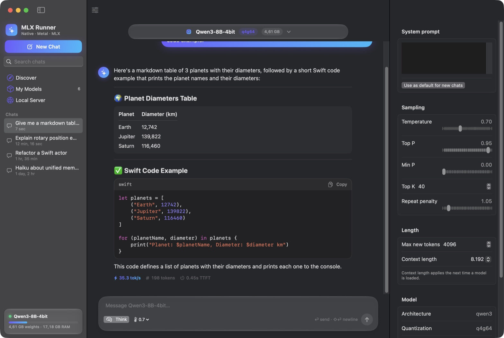

# MLX Runner

**Run MLX models on your Mac. Natively, fast, with nothing in between.**

A native macOS app for discovering, downloading and chatting with **MLX models from Hugging Face**, in the spirit of LM Studio. It is written entirely in Swift, with its own Metal inference engine. Made by [21no.de](https://21no.de).

**[Download at mlx-runner.21no.de](https://mlx-runner.21no.de)**: a `.dmg` for Apple silicon Macs (macOS 15+) and the `mlxr` command-line tool. Every release ships an Ed25519-signed `SHA256SUMS` and signed build provenance; see [verifying a download](#verifying-a-download).



- **Zero third-party dependencies.** The project uses the Swift standard library and Apple's system frameworks only: SwiftUI, Foundation, Metal, Network and CryptoKit. It has no SwiftPM packages, no vendored code and no Python.
- **Native MLX format.** It reads MLX-community repos directly: memory-mapped `safetensors` plus MLX affine quantization at 2, 3, 4, 5, 6 or 8 bits, with group sizes of 32, 64 or 128.
- **Fast.** Hand-written Metal kernels cover every layer:
  - fused decode matvecs
  - simdgroup-matrix GEMMs for prefill
  - flash attention
  - KV-cache prefix reuse across chat turns
- **Signed updates.** "Check for Updates…" installs a new release only after its Ed25519 signature, its SHA-256 and the app's code signature all verify, then swaps it in atomically and restarts.

> **On "native MLX support" with "no external dependencies":** Apple's `mlx-swift` is a third-party package, so it is not used. MLX Runner runs MLX *models* with an engine written from scratch on Metal instead. It loads the same files `mlx-lm` uses, so any compatible `mlx-community` repo works without conversion.

## Install

1. Download `MLX-Runner-<version>-macos-arm64.dmg` from [mlx-runner.21no.de](https://mlx-runner.21no.de) or the [releases page](https://github.com/BackendStack21/mlx-runner/releases/latest).
2. Open it and drag **MLX Runner** to Applications.
3. The app is ad-hoc signed, not notarized by Apple, so the first launch needs one extra step: right-click the app and choose **Open**, or run
   `xattr -dr com.apple.quarantine "/Applications/MLX Runner.app"`.

Later versions arrive through **MLX Runner → Check for Updates…**. The app checks GitHub at launch and every 6 hours; turn that off in Settings.

The CLI: unpack `mlxr-<version>-macos-arm64.tar.gz` and put `mlxr` on your `PATH`.

### Verifying a download

```bash
shasum -a 256 -c SHA256SUMS --ignore-missing                       # checksums
gh attestation verify MLX-Runner-1.0.0-macos-arm64.dmg --repo BackendStack21/mlx-runner   # build provenance
```

`SHA256SUMS.sig` is a raw Ed25519 signature of `SHA256SUMS` by the key in [`packaging/update-key.pub`](packaging/update-key.pub); the in-app updater refuses anything it doesn't verify.

## Features

**Discover**
- Search the Hugging Face Hub for MLX models (`library: mlx`), sorted by downloads, likes, trending or recency.
- Every result shows its exact architecture (read from `config.json`) and its quantization. A "Runnable only" filter hides models the engine can't run.
- A "Recommended for this Mac" strip lists curated picks that fit your memory.
- The detail pane shows the model card, download size, and a check of whether the model fits in memory.

**Downloads**
- Background downloads with progress, speed and cancel.
- Interrupted downloads resume with HTTP range requests, and every LFS file is checked against its SHA-256 from the Hub.
- A Hugging Face token (Settings) is stored in the Keychain and only ever sent to huggingface.co hosts, never to the CDN a download redirects to. The gated-model path hasn't been tested against a real gated repo.

**My Models**
- A card grid of installed models with load, eject, delete and "Show in Finder".
- Models already in your `~/.cache/huggingface/hub` (for example from `mlx-lm`) are picked up automatically.

**Chat**
- Streaming responses with Markdown rendering: headings, lists, tables, quotes, and code blocks with syntax highlighting and copy.
- Qwen3 thinking mode: reasoning appears in a collapsible "Thought for N s" block, and a toggle turns it off.
- Live tok/s while generating. Each reply also shows tok/s, token count and time to first token.
- Edit and resend, regenerate, copy, a per-chat system prompt, and searchable, persistent chat history.
- An inspector panel for temperature, top-p, top-k, min-p, repeat penalty, max tokens and context length.

**Local Server**
- OpenAI-compatible: the Responses API (`POST /v1/responses`, with typed streaming events), Chat Completions (`developer` role, content parts, `max_completion_tokens`, `stream_options.include_usage`), legacy Completions, and `/v1/models`.
- Qwen3 thinking is returned as `reasoning_content` (Chat Completions) or a `reasoning` item (Responses).
- Features it can't honour (tools, JSON mode, images, logprobs) are rejected with an OpenAI-style 400 instead of being silently ignored.
- Safe by default: binds to localhost, rejects other `Host` headers (DNS rebinding) and unknown browser `Origin`s, accepts JSON bodies only, and enforces timeouts plus connection, queue and size limits. An API key is optional on localhost and required in LAN mode.
- Includes a request log.

**Reliability and security**
- Model files are untrusted input: safetensors headers, tensor offsets, config dimensions, token ids and every weight shape are validated before anything reaches the GPU.
- Chat message text is tokenized as plain text, so a message can't inject control tokens and forge turns.
- Links in model cards and replies open only for https (with a confirmation for non-Hugging Face hosts) and mailto.
- Chat history is never overwritten if it can't be read; it is saved on send and on quit.
- A memory guard refuses models that won't fit in GPU-addressable memory, with a clear message.
- Long chats are trimmed to fit the context window, oldest turns first. The system prompt and the latest message are always kept.
- Cancellation is per request, so the server and the chat UI never cancel each other.
- Errors such as a gated model, a network failure, a full context or an unsupported architecture surface in the UI.

## Supported models

| `model_type` | Verified checkpoint | Notes |
|---|---|---|
| `qwen3` | Qwen3-0.6B-4bit | per-head q/k RMSNorm, thinking toggle |
| `qwen2` | Qwen2.5-0.5B-Instruct-4bit | q/k/v biases |
| `llama` | Llama-3.2-1B-Instruct-4bit | Llama-3 RoPE scaling |
| `mistral` | Mistral-7B-Instruct-v0.3-4bit | SentencePiece BPE + byte fallback |
| `phi3` | Phi-3.5-mini-instruct-4bit | fused qkv / gate_up, LongRoPE |

Each checkpoint above passes end-to-end generation and the prefill-versus-decode consistency test. Other models of the same type, such as larger Qwen3, Qwen2.5-Coder or other Llama 3 fine-tunes, should work too, unless they need a feature that isn't implemented, such as sliding-window attention.

## Limitations

- **Unsupported model types:** Gemma, mixture-of-experts (Mixtral, Qwen3-MoE) and vision-language models. Discover marks them as not runnable.
- **Chat templates:** the prompt format is detected (ChatML, Llama 3, Mistral, Phi-3) rather than executed as Jinja, so a model with an unusual template may get a near-match format.
- **Prefill speed:** about 165 tok/s on a 7B model on an M2 Pro, because the prefill GEMM reaches about 35% of fp32 peak.
- **Speculative decoding is opt-in.** Prompt-lookup drafting with exact verification is implemented and tested (greedy output is identical), but checking 4 drafted tokens on a 7B model still costs about 3 decode steps. So it only helps when most drafts are accepted (copying or editing text), and it is off by default (`SamplingParameters.speculative`, or `mlxr run --spec`).
- **Glass effects:** set `MLXRUNNER_NO_GLASS=1` to use plain materials instead of Liquid Glass.

## Performance

Measured with `mlxr bench` on an **M2 Pro (16 GB)**. Decode is measured with greedy sampling.

| Model (4-bit) | Weights | Prefill (512 tok) | Decode @16 | Decode @1K ctx |
|---|---|---|---|---|
| Qwen2.5 0.5B Instruct | 278 MB | 2,970 tok/s | 285 tok/s | 258 tok/s |
| Qwen3 0.6B | 336 MB | 2,030 tok/s | 247 tok/s | 204 tok/s |
| Llama 3.2 1B Instruct | 695 MB | 1,170 tok/s | 183 tok/s | 165 tok/s |
| Phi-3.5 mini | 2.15 GB | 320 tok/s | 65 tok/s | 57 tok/s |
| Mistral 7B v0.3 | 4.08 GB | 166 tok/s | 38.6 tok/s | 36.6 tok/s |

**The 7B ceiling.** Decoding one token reads every weight once, so speed is capped by memory bandwidth. This M2 Pro measures 197 GB/s with a plain read kernel, which caps a 4.08 GB model at about 48 tok/s. MLX Runner reaches 38.6 tok/s, about 82% of that cap. Reaching 50+ tok/s on a 4-bit 7B model therefore needs one of: a Mac with more bandwidth (M-series Max chips have about 400 GB/s), a 3-bit model (which would raise the ceiling to about 60 tok/s, but only 4-bit has an optimized decode kernel so far), or speculative decoding (see Limitations).

Load times stay short because the weights are `mmap`ed and wrapped in Metal buffers with no copy: about 0.5 s for the small models, 1.6 s for Phi-3.5 and 3.3 s for Mistral 7B. Those figures include a warm-up pass that pages the weights in.

## Build and run

Requirements: Apple Silicon, macOS 15 or newer, and Xcode or its command-line tools (Swift 6).

```bash
make app        # builds "build/MLX Runner.app" (release, ad-hoc signed, with icon)
make run        # builds and opens it
make test       # runs the test suite
make cli        # builds the `mlxr` command-line tool
```

You can also run the app without bundling it: `swift run -c release MLXRunner`.

Models are stored in `~/Library/Application Support/MLX Runner/models/<org>/<repo>`.

## Command line (`mlxr`)

```bash
mlxr search qwen3                           # search MLX models on the Hub
mlxr download mlx-community/Qwen3-4B-4bit   # download into the app's library
mlxr list                                   # installed models
mlxr run mlx-community/Qwen3-4B-4bit -p "Explain RoPE" --max 300 [--temp 0.7] [--no-think]
mlxr serve mlx-community/Qwen3-4B-4bit --port 1234     # OpenAI-compatible server (--lan prints an API key)
mlxr bench mlx-community/Qwen3-4B-4bit      # prefill/decode throughput + kernel micro-benchmarks
mlxr tokenize <model> "some text"
```

## Architecture

```
Sources/
  MLXEngine/            Inference engine (library)
    Kernels.swift       Metal shader source, compiled at runtime
    GPU.swift           Device and pipelines; zero-copy safetensors loader
    Transformer.swift   Model graph: one command buffer per step, fused kernels
    Tokenizer.swift     BPE from tokenizer.json (byte-level and SentencePiece)
    ChatTemplate.swift  ChatML / Llama 3 / Mistral / Phi-3 prompt formats
    Engine.swift        Generation loop, sampler, KV-prefix reuse, cancellation, context fitting
    Hub.swift           Hugging Face API client and downloader
    ModelStore.swift    Local library and HF-cache scanning
    OpenAIServer.swift  OpenAI-compatible HTTP server (Network.framework)
  MLXRunner/            SwiftUI app
  mlxr/                 CLI
Tests/MLXEngineTests/   Swift Testing suite
```

How the engine works:

- **Decode** (one token per step):
  - q/k/v and gate/up are each one fused quantized matvec over several zero-copy weight matrices, with bias folded in.
  - Per-head RMSNorm, RoPE and the KV-cache append run as a single kernel.
  - The residual add is fused with the next RMSNorm.
  - Attention uses online softmax across 16 to 32 simdgroups.
- **Prefill:**
  - Quantized GEMMs on `simdgroup_matrix` tiles; each weight tile is dequantized once and shared by 32 tokens.
  - Flash attention on simdgroup matrices: 8×8 tensor ops for Q·Kᵀ and P·V, with the softmax rescale done as a diagonal-matrix multiply.
- **Chat:** prompt tokens shared with the previous request are skipped, so follow-up turns start almost instantly.

## Tests

`make test` runs the suite:

- GPU quantized matmul kernels for every bit width, group size and scale dtype, across all three code paths (decode matvec, small-batch, prefill GEMM), each compared against a CPU reference.
- Fused multi-matrix decode with bias, dense f16 matmul, and the quantized embedding lookup.
- Tokenizer known ids and Unicode round-trips; chat templates; sampler behavior (greedy, repetition penalty, top-k, top-p, seeding); the safetensors loader, including misaligned tensors.
- On real models:
  - Prefill and token-by-token decode produce the same next-token distribution, for all five architectures.
  - KV-cache reuse works on follow-up turns.
  - Long conversations are trimmed to fit.
  - Cancelling one request leaves others untouched.

Tests that need a model are skipped when it isn't installed. Download a model with `mlxr download <repo>`.

## Releasing

1. Bump `MLXRunnerVersion.current` in `Sources/MLXEngine/Version.swift` and add a `## <version>` section to [CHANGELOG.md](CHANGELOG.md).
2. Commit, then tag and push: `git tag v1.2.3 && git push origin main v1.2.3`.
3. The [release workflow](.github/workflows/release.yml) refuses a tag that doesn't match `Version.swift`, runs the tests, builds the app and CLI on a clean runner, signs `SHA256SUMS` with the `MLXRUNNER_UPDATE_KEY` secret, attests build provenance and publishes the GitHub release. Installed apps pick it up through the updater; the landing page reads it from GitHub's API.

`make release` runs the same packaging locally into `dist/release/` (without the signature). The signing key pair is created once with `swift scripts/release-key.swift`, which stores the private key in the repository secret and writes the public key into `packaging/update-key.pub` and `Sources/MLXEngine/UpdateKey.swift`.

## License

[MIT](LICENSE) © 2026 [21no.de](https://21no.de)
